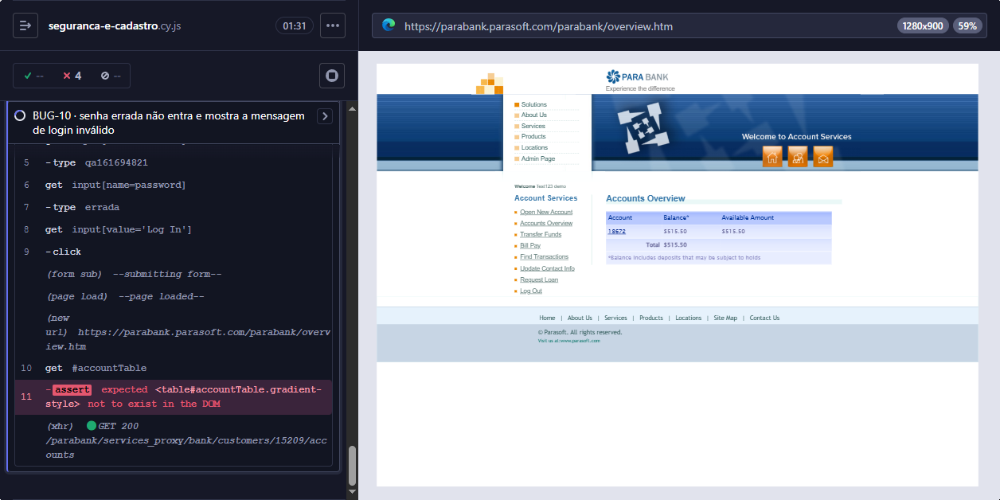

# BUG-10: Senha errada não é recusada: às vezes dá erro, às vezes abre uma conta

| Campo | Valor |
|---|---|
| Ambiente | https://parabank.parasoft.com/parabank, Edge, Windows 10, novembro de 2026 |
| Severidade | Crítica (minha avaliação: a senha deixa de proteger a conta) |
| Prioridade | Alta |
| Risco do plano | R03 |
| Teste que detecta | `cypress/e2e/defeitos/seguranca-e-cadastro.cy.js` › BUG-10 |

## Passos para reproduzir
1. Começar **sem sessão**: o teste roda `cy.clearCookies()` antes de abrir a página, e o Cypress isola cada teste.
2. Na página inicial, informar o usuário de um cliente existente, criado pelo próprio teste, e a senha `errada`.
3. Clicar em **Log In**.
4. Repetir algumas vezes.

## Resultado esperado
O acesso é negado com a mensagem **The username and password could not be verified.**

## Resultado obtido
O resultado muda de uma tentativa para outra. Nas execuções, apareceram três comportamentos:

1. **An internal error has occurred and has been logged.**
2. A área logada abre com as contas do próprio cliente do teste, mesmo com a senha errada.
3. A área logada abre com os dados de **outro cliente**.

### Como sei que era outro cliente
Não foi só o nome de boas-vindas. A tela carregou as contas e os saldos de um cliente que o teste não criou:

| Execução | Nome exibido | Cliente carregado pela tela | Contas exibidas |
|---|---|---|---|
| 1 | John Smith | `GET /customers/12212/accounts` | 13 contas, algumas com saldo negativo |
| 2 | test123 demo | `GET /customers/15209/accounts` | conta 18672, saldo $515.50 |

Os clientes criados pela suíte se chamam sempre "Ana Souza" e têm só a conta principal e as contas abertas pelos próprios testes.

### O que eu não sei
A causa. O teste é caixa-preta e eu não vejo o servidor. O ParaBank é público e usado por muita gente ao mesmo tempo, e "john" e "test123" são usuários de demonstração comuns. Uma hipótese é a sessão de outra pessoa ser associada à minha requisição, mas não consigo comprovar de fora.

## Impacto
Mesmo sendo intermitente, é o defeito mais grave do projeto: a senha deixa de proteger a conta, e uma pessoa pode ver as contas e os saldos de outra.

## Evidência
- Print acima, tirado pelo Cypress no momento da falha.
- Rode `npm run test:defeitos`: o teste deste defeito falha, e o Cypress guarda o print em `cypress/screenshots`. Como o defeito é intermitente, o comportamento pode variar entre as execuções.

## Reteste
O teste descreve o comportamento correto. Quando o defeito for corrigido, ele passa: nessa hora, mova-o para `cypress/e2e/regressao`, onde ele protege contra a volta do bug. Por ser intermitente, vale rodar o reteste várias vezes antes de considerar corrigido.
